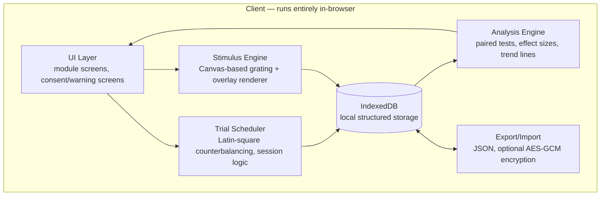

# PerceptLab — Personal Visual-Perception Self-Assessment Toolkit

**Design Document v0.1**
**Author:** Jack (with drafting assistance from Claude)
**Status:** Draft, pre-implementation
**Scope:** Single-user, client-side web application, no backend

---

## 0. Executive Summary

PerceptLab is a personal-use web application for systematically characterising a specific perceptual phenomenon (illusory motion/flicker/rotation triggered by dense text and high-contrast striped patterns) and empirically testing candidate interventions (colour overlays, typography changes, reading aids).

It is built around two working hypotheses, developed from prior symptom description:

1. **Visual stress / pattern glare** — a well-documented sensitivity to high-contrast repetitive striped patterns (including the stripe-like structure of dense text), associated with cortical hyperexcitability, tested clinically via the Wilkins & Evans Pattern Glare Test and treated via coloured overlays/tints.
2. **Convergence insufficiency (CI) / binocular vision dysfunction** — a mechanically distinct issue where the eyes struggle to team up for near work, producing "swimming," lost place, and fatigue during reading specifically, screened clinically via the CISS questionnaire and near-point-of-convergence testing.

These are not mutually exclusive, and the tool is explicitly designed to help distinguish which (if either, if both) is contributing, and to quantify what interventions actually help — rather than relying on impression.

**This is a self-quantification instrument, not a diagnostic device.** Section 12 covers this in detail and should be read before trusting any score the app produces.

---

## 1. Purpose & Non-Goals

### 1.1 Purpose

- Produce structured, timestamped, quantitative data on: symptom frequency/severity, susceptibility to controlled pattern stimuli, reading performance under varying conditions, and binocular vision indicators.
- Systematically test interventions (colour, contrast, spacing, font, reading aids) using a repeated-measures design robust enough to distinguish real effects from noise, expectation bias, and time-of-day variation.
- Produce an exportable summary that makes a subsequent optometrist/GP appointment more efficient and evidence-based, by arriving with concrete data rather than a verbal description.

### 1.2 Explicit Non-Goals

- **Not a diagnostic tool.** No score this app produces should be read as "you have condition X." At best, scores indicate "this pattern is consistent with, and worth discussing with, a specialist in Y."
- **Not a replacement for a comprehensive eye exam**, particularly a binocular vision / convergence assessment, which requires equipment (prism bars, phorometers) this app cannot replicate.
- **Not a photosensitive-epilepsy screening tool.** Given no history of loss-of-awareness, jerking, or blackouts, this is a low-probability concern — but the app will not include flicker/strobe stimuli at all (see §9), so it is not designed to elicit or test for this and should not be treated as having ruled it out. If any seizure-like symptom ever appears, that goes to a GP immediately, independent of this app.
- **Not multi-user or clinically deployed.** Single-user, local-first, no accounts, no backend by default.
- **Not clinically validated.** The custom questionnaires here are *inspired by* validated instruments (CISS, Wilkins Rate of Reading Test) but are not those instruments, are not psychometrically validated, and their scores are not equivalent to clinical cutoffs. This is called out again in §12 because it matters.

---

## 2. Background & Clinical Rationale

Summarised from prior discussion, with sourcing:

- **Pattern glare** is characterised by visual perceptual distortions and discomfort on viewing striped patterns, is more pronounced in people with migraine or visual stress, and is assessed clinically with the Wilkins & Evans Pattern Glare Test using square-wave gratings at 0.5, 3, and 12 cycles per degree (cpd) — 3 cpd, high contrast, ~50% duty cycle produces the strongest effect in susceptible individuals ([Evans & Stevenson 2008](https://onlinelibrary.wiley.com/doi/full/10.1111/j.1475-1313.2008.00578.x); [Pattern glare: effects of contrast and colour](https://pmc.ncbi.nlm.nih.gov/articles/PMC4621622/)).
- Text itself forms a stripe-like pattern (horizontal text lines, vertical letter strokes) and can trigger the same mechanism in susceptible readers — the proposed link between the wallpaper reaction and the reading difficulty ([Wilkins & Nimmo-Smith, cited in Dyslexia & Vision overview](https://visionhelpfordyslexia.wordpress.com/tag/pattern-glare/)).
- Coloured overlays/tints are the standard intervention studied for visual stress, with individually-specific optimal colour, and have measurable effects on reading speed in controlled studies ([Pattern glare: effects of contrast and colour, Frontiers 2015](https://www.frontiersin.org/journals/psychology/articles/10.3389/fpsyg.2015.01651/full)).
- **Convergence insufficiency** is a binocular coordination disorder, distinct from acuity, that does not show up on a standard eye chart, and produces exactly the symptom cluster described (words moving/jumping/swimming, losing place, fatigue on near work) ([NEI/NIH](https://www.nei.nih.gov/eye-health-information/eye-conditions-and-diseases/convergence-insufficiency); [AOA](https://www.aoa.org/healthy-eyes/eye-and-vision-conditions/convergence-insufficiency)).
- CI is screened with the **CISS**, a validated 15-item, 0–4 Likert questionnaire (never/infrequently/sometimes/fairly often/always), total range 0–60, with a score ≥21 in adults (≥16 in children/some cutoff studies use ≥15) generally considered indicative of symptoms warranting clinical follow-up ([CISS validity/reliability, ResearchGate](https://www.researchgate.net/publication/8395183_Validity_and_reliability_of_the_revised_convergence_insufficiency_symptom_survey_in_adults); [CISS in young adults](https://www.journalofoptometry.org/en-convergence-insufficiency-symptom-survey-ciss--articulo-S1888429621000212)).
- Reading performance under visual stress is clinically measured with the **Wilkins Rate of Reading Test (WRRT)**: passages built from a small set (~15) of high-frequency, unrelated words arranged in pseudo-random order and tightly spaced, so that reading speed reflects visual/perceptual factors rather than comprehension or vocabulary — read aloud, scored in correct words per minute, with multiple equivalent passages used across conditions to control for practice effects ([WRRT methodology, Frontiers 2024](https://www.frontiersin.org/journals/psychology/articles/10.3389/fpsyg.2024.1448817/full); [WRRT reliability](https://www.researchgate.net/publication/14263476_Rate_of_Reading_TestR_Its_reliability_and_its_validity_in_the_assessment_of_the_effects_of_coloured_overlays)).

The actual WRRT passages and the actual CISS instrument are copyrighted/commercial clinical materials. PerceptLab implements **original tools built on the same published design principles** (parameters like spatial frequency, word-count-per-line, and Likert structure are factual/methodological, not copyrightable expression) rather than reproducing the proprietary materials themselves. This also means PerceptLab's scores are *not* directly comparable to published clinical norms — see §12.

---

## 3. Design Principles

1. **Local-first, privacy-first.** This is personal health-adjacent data. No server, no account, no telemetry, by default. Data lives in the browser (IndexedDB) and is exportable/importable as a file you control.
2. **Safety before elegance.** No stimulus in this app should be able to cause acute harm. See §9 — this materially constrains what Module B is allowed to render.
3. **Rigour over vibes.** Every intervention test uses counterbalancing, multiple trials, and basic inferential statistics rather than "I tried the blue overlay once and it felt better." Single-trial impressions are exactly the kind of thing this tool exists to correct for.
4. **Legible uncertainty.** Every score the app shows is presented with its confidence/sample-size caveat attached, not as a bare number.
5. **Exportable, not just visualisable.** The end product of a data-collection phase should be something you can print or screen-share to an optometrist, not just a personal dashboard.

---

## 4. System Overview



- **No backend in the default configuration.** Everything described below runs client-side.
- **Rendering:** Canvas 2D for all stimulus generation (gratings, overlays, reading grids) — needed for pixel-accurate control of spatial frequency and contrast, which SVG/DOM text rendering cannot guarantee across browsers/OS font rendering.
- **Charting:** Chart.js for the analytics dashboard (trend lines, per-condition comparison plots).
- **Storage:** IndexedDB, not localStorage — this data will exceed localStorage's practical size/complexity limits once you have weeks of trial-level data, and IndexedDB supports structured querying by session/date/condition.

---

## 5. Module Specifications

### Module A — Structured Symptom Intake

**Purpose:** Baseline, repeatable symptom quantification, taken periodically (e.g. weekly) to track trend, not just once.

**Contents:**
- A **CI-symptom-inspired 15-item checklist**, covering the same domains as the CISS (eye strain/tiredness, headache, blur, diplopia, words moving/jumping/swimming, losing place, re-reading lines, sleepiness, difficulty concentrating during near work), each scored 0–4 (never → always). Sum → 0–60 scale, mirroring CISS structure so you can track change over time — **explicitly labelled as CISS-inspired, not the validated CISS**, with a note recommending the real CISS if seeing a specialist.
- A **visual-stress checklist**, covering: illusions of movement, colour fringing, shape distortion, flicker, blur, and physical discomfort (headache/eyestrain/nausea), each rated 0–4 for both (a) frequency and (b) severity when it occurs.
- A **free-text + tag-based trigger note** ("what were you looking at when this last happened") — feeds Module F.

**UI flow:** Single scrollable form, ~5 minutes, auto-saved per question (no "lost my answers" risk), timestamped, linked to a `SessionMeta` record capturing sleep/caffeine/screen-time/time-of-day context (§7) since these are known confounders for both visual stress and CI symptoms.

**Output:** `SymptomSurveyResponse` records, plotted over time in Module G.

---

### Module B — Pattern Glare / Visual Stress Battery

**Purpose:** Approximate, self-administered version of the clinical Pattern Glare Test.

**Stimulus design:**

| Spatial frequency | Purpose |
|---|---|
| 0.5 cpd | Low-frequency control (should produce minimal effect in most people) |
| 3 cpd | Main test condition — the frequency shown to produce maximum pattern glare effect in susceptible individuals |
| 12 cpd | High-frequency control |

- Square-wave (hard-edged, not sinusoidal) black/white gratings, ~50% duty cycle, full contrast, both horizontal and vertical orientation, generated on `<canvas>`.
- **Exposure protocol:** show grating for a fixed 10 seconds (matches the general clinical protocol of brief exposure + structured questioning), then remove and immediately present the illusions checklist below. Enforced minimum 30-second neutral-grey rest between trials.
- **Post-exposure checklist** (multi-select, not leading yes/no):
  - Apparent motion (shimmering, moving, streaming)
  - Colour fringing (colours appearing in a black/white pattern)
  - Shape distortion (curves/bending where lines are straight)
  - Flicker
  - Blur
  - Discomfort rating, 0–10 (separate from the illusion checklist — illusions and discomfort are theoretically dissociable and both worth recording)

**Trial structure:** Each of the 3 frequencies × 2 orientations = 6 conditions, each repeated 3× within a session in randomised order (not blocked by frequency, to avoid order/anticipation effects), for 18 trials per full battery. A "quick battery" mode (3 cpd only, both orientations, 3 reps = 6 trials) is offered for lower-friction repeat testing.

**Critical accuracy caveat — screen calibration:** cycles-per-degree is a function of *visual angle*, not pixels. Getting this right requires knowing your viewing distance and physical stripe width on-screen. See §8 for the full calibration procedure and its formula. Without calibration, the "3 cpd" condition is a guess, not a measurement — the app should never let a grating render without a completed calibration record for that device.

---

### Module C — Reading Performance Battery

**Purpose:** Objective reading-speed/error measurement under different visual conditions, built on WRRT design principles (not the proprietary WRRT materials).

**Passage generator algorithm:**
1. Maintain a bank of ~15–20 short, high-frequency English words (e.g. common function words and short concrete nouns), matched roughly for length.
2. For each passage: generate *N* lines (default 10) × *M* words per line (default 8–10), each line a pseudo-random permutation of the word bank such that:
   - No word is immediately repeated within a line.
   - Word frequency across the whole passage is approximately balanced (avoid any one word dominating, which would let recognition-by-shape substitute for actual reading).
3. Generate multiple (≥6) passages this way at initialisation, verify by eye that none look pathological (e.g. accidental real phrase), and reuse this fixed passage set across all future sessions — **do not regenerate passages per-session**, or you lose the ability to compare across time (the equivalence between passages is itself something the WRRT literature had to validate empirically; simplest safe approach is to fix a small set once and reuse it deliberately, tracking which passage ID was used in which trial so any passage-specific effects can be checked for later).

**Trial protocol:**
- Passage rendered tightly spaced, single font (fixed per condition being tested), on-screen.
- Timer starts on a keypress/tap (reader-initiated, avoids reaction-time confound), stops on completion (self-paced silent reading, since read-aloud requires audio recording infrastructure this app doesn't need for MVP — see §13 for a read-aloud stretch goal).
- After each line, log a "line complete" timestamp via keypress — this gives **per-line timing**, not just whole-passage time, which is exactly the granularity needed to test "do I lose more time on lines than expected" (a proxy for the losing-place/re-reading symptom).
- Post-trial: self-reported discomfort (0–10) and a count of subjectively noticed "line losses" (times you felt you lost your place).

**Metrics computed:** correct words per minute (cwpm), per-line time variance (high variance = inconsistent pace, worth flagging), subjective line-loss count, subjective discomfort — all tagged with the `InterventionCondition` active during that trial.

---

### Module D — Overlay & Typography Intervention Lab

**Purpose:** The actual "test what helps" engine. This is the module with the most rigour requirements, because it's the one most exposed to expectation bias.

**Interventions supported (each an `InterventionCondition`):**
- **Colour overlay:** an HSL-parameterised semi-transparent layer over the reading area (hue 0–360°, saturation, lightness, opacity sliders) — a simplified analogue of the Intuitive Colorimeter approach used in visual-stress research.
- **Dark mode / inverted contrast.**
- **Font change:** at minimum, a standard serif, a standard sans-serif, and a dyslexia-friendly font (e.g. Atkinson Hyperlegible), since font choice is a cheap, easy variable to include even though it's tangential to the core hypotheses.
- **Line spacing multiplier** (1.0×–2.5×).
- **Reading ruler overlay:** a semi-opaque horizontal band that follows a cursor/tap position, masking all lines except the current one — directly targets the "surrounding text moves while I try to focus on one word" symptom.

**Experimental design (see §6 for full methodology):**
- Every condition is tested using the **Module C reading battery** as the outcome measure (cwpm, per-line variance, discomfort), not vibes.
- Conditions are scheduled via a **Latin-square rotation** across sessions so each condition appears equally often in each ordinal position (first-tried, second-tried, etc.), controlling for fatigue/practice effects that would otherwise confound "the second thing I try always feels better."
- Minimum **5 trials per condition** before that condition is included in any comparison chart — the app should visibly grey out / mark "insufficient data (n=2/5)" for under-sampled conditions rather than silently plotting noise as signal.
- **Partial blinding:** the app avoids showing running per-condition averages *during* a data-collection phase (only after a phase is marked complete) — this stops you from unconsciously trying harder / relaxing more once you see "blue is winning," which would contaminate later trials.

---

### Module E — Binocular Vision / Convergence Screening

**Purpose:** Cheap, imperfect proxies for the two things a proper binocular vision exam would measure directly. These are screening aids to bring to an appointment, not diagnostic in themselves — this module carries the strongest "go see a specialist" framing of all of them, because self-measurement of eye alignment is inherently limited.

**Sub-test 1 — Near Point of Convergence (self-administered, low-tech):**
- Standard clinical version: bring a small target (e.g. a pen tip, or a phone showing a single letter) slowly toward the bridge of the nose while looking at it; note the distance (cm) at which it visibly doubles, or at which one eye visibly drifts outward (have Jack watch in a mirror, or better, have a second person observe eye position — solo self-observation of your own eye drift is unreliable, flag this clearly in the UI copy).
- App's role here is purely **data logging**: a simple form to record the measured break distance (cm), whether diplopia was noted, and whether it was self-observed or witnessed — with witnessed data flagged as higher-confidence.

**Sub-test 2 — Digital rapid-naming/saccade task (King-Devick-inspired):**
- Rows of single digits displayed left-to-right; user reads them aloud/aloud-adjacent (or, for a self-paced digital variant, taps a keypress after processing each row) as fast as possible.
- This is a rough proxy for saccadic control and processing speed under visual demand, used in concussion/oculomotor screening contexts — treat results as a **relative baseline tracker** (is this getting better/worse/staying flat over weeks) rather than a pass/fail test, since this app's implementation is not the validated King-Devick instrument.

**Explicit UI framing for this whole module:** a persistent banner: *"These are screening aids. A proper binocular vision assessment requires equipment this app doesn't have. Bring these results to an optometrist rather than treating them as conclusive."*

---

### Module F — Real-World Trigger Journal

**Purpose:** Capture naturalistic events (like the bathroom wallpaper) with enough structure to eventually correlate against Module B/C/D results.

**Fields:** timestamp, free-text description, optional photo attachment (stored locally — never uploaded), trigger type tag (pattern/reading/screen/lighting/other), perceived effect tags (motion/flicker/rotation/colour/other, multi-select), severity 0–10, duration estimate, and an optional link to "was I tired/stressed" context.

**Why this matters analytically:** this is the module that lets you eventually ask "do my Module B grating-discomfort scores predict which real-world patterns bother me," which is the actual point of the whole project — connecting the lab-style tests back to lived experience.

---

### Module G — Analytics & Report Dashboard

**Purpose:** Turn accumulated trial data into (a) something you can look at yourself, and (b) an exportable clinical-visit summary.

**Views:**
- **Symptom trend over time** (Module A scores, line chart, both the CI-inspired total and the visual-stress checklist total, plotted separately since they're testing different constructs).
- **Pattern glare susceptibility by spatial frequency** (Module B), grouped bar chart of illusion-count and discomfort by cpd condition, with your session-to-session variance shown (error bars), not just a single number.
- **Reading performance by intervention condition** (Module C/D), box or violin plot of cwpm per condition, with the "insufficient data" greying rule from §5.4 enforced, plus the paired-comparison statistics from §6.
- **Correlation view:** scatter of Module F real-world severity ratings against same-day Module B discomfort scores (if any), purely exploratory, clearly labelled as such given tiny expected N.

**Export:** a single-page PDF/print-formatted summary — symptom trend snapshot, best-performing intervention condition with its sample size and effect size, and raw session count — designed to be handed to or screen-shared with an optometrist.

---

## 6. Experimental Design Methodology

This is the section that separates "I tried a blue overlay and it felt better" from an actual answer, and it's worth being explicit about since it's the whole point of Module D.

- **This is an N-of-1 (single-subject) trial**, not a population study. Standard between-subject statistics (the kind used to validate CISS cutoffs) don't directly apply — the goal is within-subject comparison across repeated, counterbalanced conditions.
- **Counterbalancing:** use a Latin square over conditions × sessions, so order effects (fatigue increasing across a session, practice effects across days) are spread evenly across conditions rather than confounding any one of them.
- **Repetition:** minimum 5 trials per condition before drawing any conclusion; more for noisier subjective measures (discomfort ratings) than for objective ones (cwpm).
- **Statistical comparison:** for each pair of conditions with sufficient data, compute:
  - A paired difference (condition A cwpm − condition B cwpm, per matched session).
  - Wilcoxon signed-rank test (preferred over paired t-test by default, since it doesn't assume normality, which is a real risk at n=5–10) — report the t-test as well for reference, flag if they disagree.
  - **Effect size (Cohen's dz for paired data)** alongside any p-value — at this sample size, effect size is more informative than significance, and the UI should present it that way rather than reducing everything to "significant/not significant."
- **Confound logging:** every trial is tagged with the `SessionMeta` context (sleep, caffeine, time of day, fatigue self-rating) captured in §7, so if a comparison looks ambiguous, you can check whether it's confounded by, e.g., all "overlay" trials happening late at night.
- **Pre-registration-lite:** before starting a new intervention comparison phase, the app prompts you to state which conditions you're comparing and your prediction, timestamped — cheap, low-friction protection against unconsciously reframing "what I found" as "what I expected" after the fact.

---

## 7. Data Model

```typescript
interface ScreenCalibration {
  id: string;
  deviceLabel: string;                  // e.g. "laptop screen", "phone"
  screenDiagonalInches: number;
  resolutionPxW: number;
  resolutionPxH: number;
  measuredScreenWidthCm?: number;       // preferred: direct ruler measurement
  pixelPitchCm: number;                 // derived, see §8
  assumedViewingDistanceCm: number;     // default 50cm, override if measured
  measuredViewingDistanceCm?: number;
  calibratedAt: string;                 // ISO 8601
}

interface SessionMeta {
  id: string;
  startedAt: string;
  endedAt?: string;
  hoursSinceWaking?: number;
  sleepHoursLastNight?: number;
  caffeineMgToday?: number;
  screenTimeHoursToday?: number;
  ambientLighting?: 'dim' | 'normal' | 'bright' | 'daylight';
  fatigueSelfRating?: number;           // 1-5
  notes?: string;
}

interface SymptomSurveyResponse {
  id: string;
  sessionId: string;
  instrument: 'ci-inspired-15' | 'visual-stress-checklist';
  itemScores: Record<string, number>;   // itemId -> 0-4
  totalScore: number;
  administeredAt: string;
}

interface GratingTrial {
  id: string;
  sessionId: string;
  calibrationId: string;
  spatialFrequencyCpd: 0.5 | 3 | 12;
  orientation: 'horizontal' | 'vertical';
  contrast: number;                     // 0-1
  exposureDurationMs: number;           // fixed at 10000 by default
  illusions: {
    motion: boolean;
    colorFringing: boolean;
    shapeDistortion: boolean;
    flicker: boolean;
    blur: boolean;
  };
  discomfortRating: number;             // 0-10
  timestamp: string;
}

interface InterventionCondition {
  id: string;
  type: 'none' | 'colorOverlay' | 'darkMode' | 'fontChange' | 'lineSpacing' | 'readingRuler';
  overlayHue?: number;
  overlaySaturation?: number;
  overlayLightness?: number;
  overlayOpacity?: number;
  fontFamily?: string;
  lineSpacingMultiplier?: number;
  label: string;
}

interface ReadingTrial {
  id: string;
  sessionId: string;
  passageId: string;
  conditionId: string;                  // -> InterventionCondition
  correctWordsRead: number;
  totalWordsInPassage: number;
  errorCount: number;
  timeTakenMs: number;
  correctWordsPerMinute: number;
  perLineTimestampsMs: number[];        // for per-line variance analysis
  selfReportedLineLosses: number;
  selfReportedDiscomfort: number;
  timestamp: string;
}

interface ConvergenceTrial {
  id: string;
  sessionId: string;
  method: 'npc-selfreport' | 'npc-witnessed' | 'saccade-digital';
  nearPointOfConvergenceCm?: number;
  diplopiaReported?: boolean;
  saccadeAccuracy?: number;
  saccadeDurationMs?: number;
  timestamp: string;
}

interface JournalEntry {
  id: string;
  occurredAt: string;
  description: string;
  triggerType: 'pattern' | 'reading' | 'screen' | 'lighting' | 'other';
  perceivedEffects: string[];
  severity: number;                     // 0-10
  durationMinutes?: number;
  photoRefLocal?: string;               // local blob reference only
}
```

All records are keyed by `id` (UUID) and indexed by `sessionId` / `timestamp` in IndexedDB object stores, one store per interface above.

---

## 8. Calibration & Measurement Accuracy

Spatial frequency (cycles per degree) is defined by *visual angle*, so rendering "3 cpd" correctly on a screen requires knowing the physical size of one stripe cycle on that specific screen and your viewing distance from it. Get this wrong and the "3 cpd" condition silently isn't 3 cpd.

**Derivation** (small-angle approximation, accurate to <1% for anything under ~10° visual angle, which covers this use case):

```
angular_size_of_one_cycle_deg ≈ (cycle_width_cm / viewing_distance_cm) × (180 / π)

cpd = 1 / angular_size_of_one_cycle_deg
    ≈ viewing_distance_cm / (cycle_width_cm × 57.2958)
```

Rearranged, to render a target `cpd`:

```
cycle_width_cm = viewing_distance_cm / (target_cpd × 57.2958)
cycle_width_px = cycle_width_cm / pixel_pitch_cm
```

Where `pixel_pitch_cm = physical_screen_width_cm / horizontal_resolution_px`.

**Calibration procedure (in order of accuracy):**
1. **Best:** measure the visible screen width directly with a ruler (cm), divide by horizontal resolution in pixels → exact pixel pitch. Measure actual viewing distance with a tape measure or string at the point of testing.
2. **Good:** derive screen width from diagonal (inches, from device spec) and assumed 16:9 aspect ratio: `width_in = diagonal_in × (16 / √(16² + 9²))`, convert to cm. Use a fixed, deliberately-adopted viewing distance (e.g., "always sit with your sternum against the desk edge, phone/laptop at arm's length") rather than eyeballing it each time.
3. **Fallback default:** 50cm viewing distance, diagonal+16:9 derivation — acceptable for a first pass but should be flagged in the UI as low-confidence, and Module B trial records should carry the `calibrationId` used so any later refinement lets you know which historical trials are trustworthy.

**Known limitation:** at 12 cpd on a typical laptop screen at arm's length, the required stripe width can approach single-digit pixel counts, where anti-aliasing and subpixel rendering distort the intended square-wave profile. The app should detect this (`cycle_width_px < ~6`) and warn that the high-frequency condition may not be renderable accurately on that device — better to surface this than silently render a degraded stimulus.

---

## 9. Safety Constraints

This app deliberately shows visually provocative stimuli to someone who has told it those stimuli cause discomfort. That imposes hard constraints:

1. **No flicker/strobe stimuli, at any frequency, anywhere in the app.** Even though there's no seizure history here, temporal flicker (particularly in the ~15–20Hz range) carries a general, small photosensitive-epilepsy risk in the population, and this app has no legitimate need for it — pattern glare is assessed with *static* gratings clinically. This is a hard non-goal, not a tuning parameter. Compliant with the general spirit of WCAG 2.3.1 (no more than three flashes in any one-second period) by simply never flashing.
2. **Fixed, capped exposure duration** for grating stimuli (10s default, hard max 15s), enforced in code, not just UI convention — the trial cannot be extended by the user.
3. **Mandatory rest periods** (neutral mid-grey screen, minimum 30s) between grating trials.
4. **Global, always-visible "stop" control** that immediately blanks to neutral grey from anywhere in Module B or D, no confirmation dialog (a confirmation dialog is itself a bad idea if someone is mid-discomfort).
5. **Pre-module consent/warning screen**, shown before first use of Module B each session, plain-language description of what's about to be shown and why, with an explicit "skip this module today" option always available with no justification required.
6. **Session-length nudge:** after ~20 minutes of continuous testing, a non-blocking reminder suggesting a break, since fatigue is a known confound for both the phenomena being measured and the risk of the testing itself becoming unpleasant.

---

## 10. Privacy & Data Handling

- **No server, no accounts, no analytics/telemetry** in the default build. This is a personal tool handling health-adjacent data about yourself; the simplest privacy-preserving design is to never transmit it anywhere.
- **Storage:** IndexedDB, local to the browser/device. This means data does not automatically sync across devices — treat export/import as your sync mechanism (see below), not an afterthought.
- **Export:** full-database JSON export, human-readable, timestamped filename. Offered both plain and, optionally, AES-GCM encrypted with a passphrase (Web Crypto API `crypto.subtle`, no external dependency) for anyone who wants to back this up to cloud storage without storing raw health data there in the clear.
- **Photos** (Module F): stored as local blobs referenced by ID, never embedded directly in the exported JSON by default (keeps exports small and avoids accidentally emailing a bathroom photo to your optometrist) — offered as a separate optional export bundle.
- **Deletion:** a single "wipe all data" control, unrecoverable, no soft-delete — simplicity over cleverness for a single-user local tool.

---

## 11. Technology Stack & Implementation Notes

| Layer | Recommendation | Rationale |
|---|---|---|
| UI framework | React + TypeScript (Vite) | Structured component model suits the module-based architecture; TypeScript catches schema mismatches against §7 at compile time, which matters given how many typed records this app juggles. Plain TS/HTML is a reasonable lighter-weight alternative if you'd rather avoid framework overhead. |
| Stimulus rendering | Canvas 2D API | Pixel-exact control needed for grating spatial frequency (§8); SVG/DOM rendering is subject to OS/browser font/anti-aliasing variance that would undermine calibration. |
| Charts | Chart.js | Lightweight, sufficient for line/bar/box-style plots in Module G; a boxplot needs the `chartjs-chart-boxplot` plugin or a small custom violin renderer. |
| Storage | IndexedDB via a thin wrapper (e.g. `idb`) | Structured, queryable, no practical size ceiling for this dataset; avoid raw `localStorage`, which is unsuitable for anything beyond small key-value settings. |
| Stats | Small custom module (Wilcoxon signed-rank, paired t-test, Cohen's dz) | No need for a heavy stats dependency; these are all straightforward to implement directly and worth writing yourself to actually understand what the numbers mean. |
| Encryption (optional export) | Web Crypto API (`crypto.subtle`, AES-GCM) | Native browser API, no dependency, sufficient for this threat model. |

**Testing the app itself** (software correctness, distinct from the experimental methodology in §6):
- Unit tests for the cpd↔pixel conversion formula (§8) against hand-calculated reference values.
- Unit tests for the passage generator (§5.3) verifying no immediate word repetition and bounded frequency skew.
- Unit tests for the Latin-square scheduler (§6) verifying balanced condition/position coverage over N sessions.
- Snapshot/visual test for grating rendering at known calibration values against expected stripe pixel widths.

---

## 12. Scoring, Interpretation & the Limits of Self-Testing

Read this section before trusting any number the app shows you.

- **None of the instruments here are the validated clinical originals.** The CI-inspired 15-item checklist mirrors CISS's *structure* (15 items, 0–4 Likert, same symptom domains) so you can track your own trend over time, but it has not been validated against clinical diagnosis the way the actual CISS has, and its total score should not be mapped onto the published CISS cutoff (≥21 adults) as if it were the same instrument.
- **Pattern Glare Test norms exist in the literature** but the app does not reproduce the proprietary clinical test materials, so raw illusion counts from Module B are not directly comparable to those published norms either — useful for *your own* trend over time, not for placing yourself on a population percentile.
- **Self-administered convergence testing (§5.5) is the weakest module here epistemically** — near-point-of-convergence self-observation without a witness is known to be unreliable, and there is no substitute for a proper cover test / prism bar assessment by an optometrist.
- **The point of this whole tool is to generate a well-organised conversation with a specialist**, not to replace one. The Module G export exists specifically so that conversation starts from data rather than "sometimes reading feels weird."
- **Expectation and placebo effects are real and this design mitigates but does not eliminate them** — full blinding of a colour overlay is not possible when you can see the colour. Treat any single-digit-trial "this condition looks better" result as a hypothesis for the next 5 trials to test, not a conclusion.

---

## 13. Roadmap

**Phase 1 — MVP**
- Module A (symptom intake, both checklists)
- Module B, "quick battery" mode only (3 cpd, both orientations), manual/default calibration
- Module D, colour overlay only, applied as a live tint over static sample text (no Module C timing integration yet — just "does this look/feel better" logging)
- Local IndexedDB storage, JSON export (unencrypted)
- No dashboard — raw table view of stored records is enough for v0.1

**Phase 2**
- Module C full reading battery + passage generator
- Module D fully wired to Module C as the outcome measure, Latin-square scheduling
- Module B full battery (all 3 frequencies × orientations), calibration procedure (§8) properly implemented with device profiles
- Module F journal

**Phase 3**
- Module G dashboard: trend charts, per-condition comparison plots, statistics engine (§6)
- Calibration refinement (measured, not assumed, viewing distance)
- Encrypted export
- PDF/print-formatted clinical summary export

**Phase 4 (stretch, optional)**
- Module E digital saccade sub-test
- Read-aloud audio recording + timestamping for Module C (closer to the true WRRT protocol, currently silent self-paced reading is used instead)
- Camera-assisted near-point-of-convergence measurement (using a known-size on-screen fiducial for rough distance estimation) — meaningfully harder to get right than it sounds; treat as genuinely optional

---

## 14. Open Questions / Risks

- **Screen calibration accuracy** is the single biggest threat to Module B's validity — if it's wrong, the "3 cpd" condition isn't actually testing what the clinical literature says it tests. Worth deciding early whether the ruler-measurement calibration path (§8, option 1) is mandatory before Module B is usable at all, rather than optional.
- **Self-report fatigue:** filling in symptom checklists and discomfort ratings repeatedly, honestly, over weeks, is genuinely effortful — a design that's too high-friction will just stop being used. Worth prioritising low-friction logging (few taps) over comprehensive logging, especially for Module F.
- **N-of-1 statistics are easy to over-trust once they're on a nice chart.** The UI design in §5.4/§6 (greying out under-sampled conditions, always showing effect size + sample size together) is meant to counteract this, but it's worth being deliberately sceptical of your own dashboard.
- **This document doesn't specify exact word banks, exact CI-checklist item wording, or pixel-level UI layout** — deliberately left as an implementation-time decision rather than over-specified here.

---

## 15. References

- Evans, B. & Stevenson, S. (2008). The Pattern Glare Test: a review and determination of normative values. *Ophthalmic and Physiological Optics.* https://onlinelibrary.wiley.com/doi/full/10.1111/j.1475-1313.2008.00578.x
- Pattern glare: the effects of contrast and colour. *Frontiers in Psychology* (2015). https://www.frontiersin.org/journals/psychology/articles/10.3389/fpsyg.2015.01651/full
- Pattern Glare, Visual Stress and Dyslexia: unravelling the terms. https://www.crossboweducation.com/Pattern-Glare-Visual-Stress-and-Dyslexia
- Validity and reliability of the revised Convergence Insufficiency Symptom Survey in adults. https://www.researchgate.net/publication/8395183_Validity_and_reliability_of_the_revised_convergence_insufficiency_symptom_survey_in_adults
- Convergence insufficiency symptom survey (CISS) scores are predictive of severity and number of clinical signs of CI in young adults. https://www.journalofoptometry.org/en-convergence-insufficiency-symptom-survey-ciss--articulo-S1888429621000212
- Convergence Insufficiency — National Eye Institute (NIH). https://www.nei.nih.gov/eye-health-information/eye-conditions-and-diseases/convergence-insufficiency
- Convergence Insufficiency — American Optometric Association. https://www.aoa.org/healthy-eyes/eye-and-vision-conditions/convergence-insufficiency
- Short Italian Wilkins Rate of Reading Test for repeated-measures designs. *Frontiers in Psychology* (2024). https://www.frontiersin.org/journals/psychology/articles/10.3389/fpsyg.2024.1448817/full
- Rate of Reading Test®: its reliability, and its validity in the assessment of the effects of coloured overlays. https://www.researchgate.net/publication/14263476_Rate_of_Reading_TestR_Its_reliability_and_its_validity_in_the_assessment_of_the_effects_of_coloured_overlays
- Wilkins Rate of Reading Test (Crossbow Education, commercial materials — referenced for design principles only, not reproduced). https://www.crossboweducation.com/wilkins-rate-of-reading-test
